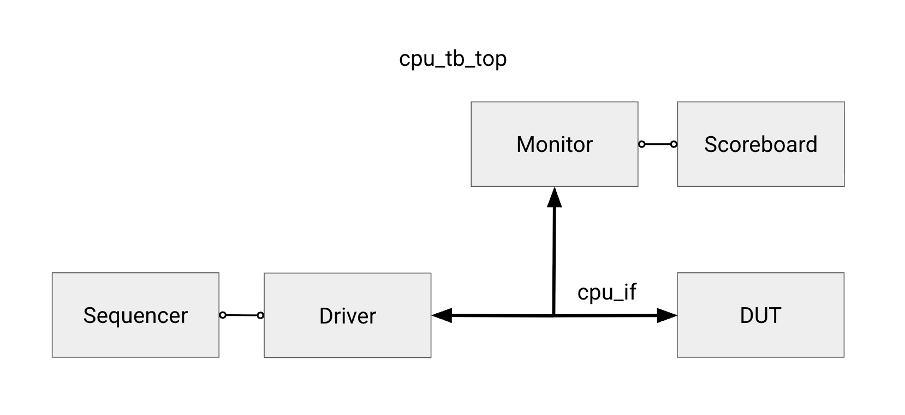
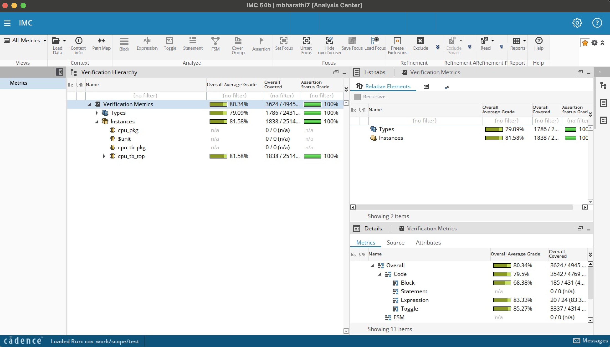

# Design Verification Onboarding — Fall 2026

## Subteam overview

### Description

The Design Verification (DV) subteam checks that a design behaves according to its specification
before it is manufactured. DV members work with RTL designers to identify functionality, write test plans,
build simulation environments, find failures, and report enough evidence for a designer to
reproduce and fix each bug.

This onboarding introduces that thought process using the CPU from the Digital Design onboarding.
You are not being asked to build another CPU or a testbench framework from scratch. The routine
class, mailbox, assembly-helper, waveform, and watchdog infrastructure is provided so you can focus
on deciding:

- what behavior needs to be tested,
- how to drive it without creating races,
- what must be observed independently,
- how to predict the correct result,
- how to recognize a failure, and
- how to show that the verification plan is complete.

> This testbench does **not** use UVM. Its sequencer, driver, monitor, scoreboard, and coverage
> components use the same separation of responsibilities found in larger UVM environments.

### Tools used

- Cadence Xcelium (`xrun`) for compilation and simulation
- Cadence SimVision for waveform debugging
- Cadence IMC for RTL code coverage
- SystemVerilog classes, mailboxes, constraints, assertions, and coverage reports

## Onboarding project

After you add your CPU RTL, the supplied verification scaffold compiles but is intentionally
incomplete.

Submit the first version of your test plan during the first week, before implementing its test cases. The plan is a working engineering document: revise it whenever coverage or debugging exposes missing behavior.

The final stage runs the same completed testbench against an encrypted CPU containing multiple
injected bugs. Finishing the onboarding means both demonstrating that your own CPU passes and using
constrained-random stimulus to find and characterize all three encrypted failures.

## Chip-level verification contract

You already learned the CPU datapath and supported instructions during Digital Design onboarding.
This section covers the external behavior that this testbench must drive and observe.

### External address map

The external port is byte addressed and accepts word-aligned accesses. `addr_i[13:12]` selects a
window:

| `addr_i[13:12]` | Window | Base | Size | Access |
| --- | --- | --- | --- | --- |
| `2'b00` | Instruction SRAM | `0x0000` | 1024 words | read/write |
| `2'b01` | Data SRAM | `0x1000` | 1024 words | read/write |
| `2'b10` | Register file | `0x2000` | 32 words | read only |
| `2'b11` | Unmapped | — | — | none |

Word `n` is located at `base + n*4`.

### External-port protocol

- A write presents `addr_i`, `wdata_i`, and `w_en_i`; the request is captured at the next rising
  edge.
- A read holds `addr_i` and `r_en_i` until `rready_o` is observed. SRAM windows respond on the
  following cycle; the register-file window responds in the request cycle.
- `w_en_i` and `r_en_i` must never be asserted together.
- The external port is serviced only while the CPU is disabled.
- Pulse `en_cpu_i` for one cycle to start a program at address zero.
- `cpu_halted_o` pulses when `ebreak` retires. A monitor must sample it every cycle rather than
  treating it as a persistent status bit.
- `halt_cpu_i` stops execution and returns the memories to the external port. Reset before starting
  another program.

### Running a program

At the chip boundary, a normal test has six phases:

1. Reset the chip and place all testbench-driven signals at idle values.
2. Write the program into instruction SRAM through the external port.
3. Write any initial values into data SRAM.
4. Pulse `en_cpu_i` to start execution.
5. Observe the halt pulse, with a bounded timeout in case the CPU is broken.
6. Read architectural state through the external port and compare it with an independent
   prediction.

That sequence is simple, but the timing and ownership changes create most of the verification work.
The driver must obey the protocol, the monitor must reconstruct what actually occurred, and the
scoreboard must not assume that driver intent became DUT behavior.

## Testbench overview



| File | Purpose | Your work |
| --- | --- | --- |
| `src/verilog/tb/cpu_if.sv` | Groups chip signals and supplies a clocking block that prevents testbench/RTL races. | Provided |
| `src/verilog/tb/cpu_seq_item.svh` | Represents one randomized instruction and encodes it into a program word. | Complete constraints |
| `src/verilog/tb/cpu_xbar_item.svh` | Represents external accesses and monitor observations. | Complete constraints |
| `src/verilog/tb/cpu_sequencer.svh` | Generates programs/accesses and sends them to the driver through a mailbox. | Provided |
| `src/verilog/tb/cpu_driver.svh` | Converts high-level requests into cycle-accurate chip pin activity. | Complete protocol tasks |
| `src/verilog/tb/cpu_monitor.svh` | Samples the interface and turns observed behavior into transactions. | Complete delayed-read and CPU-memory reconstruction |
| `src/verilog/tb/cpu_ref_model.svh` | Executes the supported architecture without modeling pipeline timing. | Provided; may be extended |
| `src/verilog/tb/cpu_sb.svh` | Maintains independent state and compares DUT observations with predictions. | Complete CPU prediction and checking paths |
| `src/verilog/tb/cpu_tb_pkg.sv` | Holds shared types, constants, helpers, and class includes. | Provided |
| `src/verilog/tb/cpu_tb_top.sv` | Instantiates the DUT and components, runs tests, and contains assertions. | Add tests and assertions |
| `Fall-26-Onboarding-TestPlan-Template.md` | Plan organized like the testbench: functional, chip-level, random, assertion, coverage, and bug-hunt sections. | Copy into initial and final plans |
| `sim/behav/Include/member.include` | Lists the your CPU and testbench sources compiled by Xcelium. | Update only if filenames differ |
| `sim/behav/Makefile` | Provides the simulation, waveform, coverage, and bug-hunt commands. | Provided |

### How the components cooperate

The **sequencer** decides what operation should be attempted. It sends transaction objects through
a mailbox to the **driver**, which is the only class allowed to drive DUT inputs.

The **monitor** independently samples signals at the chip boundary. It converts observed requests,
responses, CPU memory operations, reset, start, and halt into transactions for the **scoreboard**.
The monitor never asks the driver what it intended to do.

The scoreboard keeps shadow copies of instruction and data memory. When it observes a CPU start, it
loads those shadows into the supplied **reference model**. The model predicts architectural state
and ordered stores without relying on DUT timing. Later monitor transactions are checked against
those predictions.

This separation matters. If the scoreboard used the driver's requested data as proof of what the
DUT received, a broken driver or DUT interface could agree with the scoreboard and falsely pass.
Good verification needs an independent observation path and an independent source of expected
behavior.

**Code coverage** answers “which DUT implementation structures executed?” It does not prove
correctness by itself: tests still need expected-value checks, and uncovered RTL requires
investigation.

## Project stages

### 1. Write the first test plan

Copy [the Markdown test-plan template](Fall-26-Onboarding-TestPlan-Template.md) to
`testplan_initial.md` and submit it before writing test cases. Keep that reviewed copy unchanged;
make `testplan_final.md` for revisions during implementation and coverage closure. Markdown is used
so programs, assertions, commands, and expected values remain readable and copyable. For each
planned scenario, identify:

- the functionality or requirement,
- the stimulus and relevant initial state,
- the externally observable expected result,
- which component provides that expected result,
- the evidence that would distinguish a DUT failure from a testbench failure.

The first-week plan is a preliminary implementation outline. Duplicate the detailed test record and
add table rows as needed. In the final revision, record what changed after simulation. Do not silently
rewrite the original reasoning when results contradict it; the revision history is part of the DV work.

When planning constrained-random tests, look through `src/verilog/tb/cpu_seq_item.svh` for the
instruction constraints, and `src/verilog/tb/cpu_xbar_item.svh` for the external-port constraints. 
Use those constraint blocks to guide the plan for what stimulus is already covered and
what still needs to be completed.

Do not make a checklist containing only one friendly example per operation. Think about value
classes, limits, state transitions, dependencies between adjacent operations, ownership changes,
and interactions between otherwise-correct features. The point is to explain why the selected
tests demonstrate the specified behavior, not to guess the golden test list.

### 2. Set up the environment

1. Sign the [Cadence EULA](https://eulas.ece.gatech.edu/cadence/), selecting research under advisor
   Visvesh Sathe and project SiliconJackets.
2. Connect to `ece-rschsrv.ece.gatech.edu` using FastX, MobaXterm, or another X-capable client.
3. Run `tcsh` to enter the C shell.
4. Run `source /tools/software/cadence/setup.csh` to load the Cadence tools. You may add the setup
   command to `~/.my-cshrc` so it runs when you start `tcsh`.
5. Clone this repository and enter `sim/behav`.

Useful commands:

```sh
make help        # list the supported targets
make xrun        # compile and run your CPU with the repeatable default seed
make simvision   # open your CPU waveform
make coverage    # open your coverage database in IMC
```

`make xrun` reads `member.include`, creates symbolic links under `WORKSPACE`, compiles with
Xcelium, and runs `cpu_tb_top`. The first run will stop at the earliest unfinished TODO. That is an
onboarding checkpoint, not a syntax failure.

### 3. Add your CPU RTL

Copy only your SystemVerilog CPU RTL into `src/verilog/cpu/`. Do not copy the previous project's
Makefile, memory-image flow, tests, or simulation scripts. The supplied `chip_top` expects the
existing `cpu_top` interface. If your implementation uses additional or differently named RTL
files, update the CPU section of `sim/behav/Include/member.include`.

Do not modify `chip_top.sv`, `memory_controller.sv`, `sram_wrapper.sv`, or the SRAM macro as part of
the normal onboarding solution.

### 4. Complete protocol, monitoring, and checking

Complete and debug one component milestone at a time:

| Milestone | What is already supplied |
| --- | --- |
| Driver | Mailbox dispatch, limits, and recovery bookkeeping |
| Monitor | Reset/start/halt recognition, protocol checks, and external writes |
| Scoreboard | Reset, shadow writes, and a complete external-read comparison |
| Constraints | A mix of complete examples |
| Tests | Test lifecycle, smoke test, halt-path smoke, and helpers |
| Assertions | One complete assertion and shared failure accounting |

Each TODO states an observable contract without prescribing the golden implementation. Before
writing code:

1. Find the relevant signals in `cpu_if.sv` and the protocol requirement in this README.
2. Decide which clocking event owns each drive or sample.
3. Identify state that must survive between cycles and state that reset must clear.
4. Decide how the component will fail if the DUT does not respond.
5. Run the smallest available scenario and inspect both the log and waveform.

Start with the driver, then the monitor, then the scoreboard. Re-run after each milestone. A
simulation may reach several kinds of event in one scenario, so the next failure is evidence about
the next missing runtime path—not necessarily the next numeric TODO. The supplied handlers are
working examples of component responsibilities, not proof that the remaining behavior is correct.

A useful mismatch reports the active test, operation, location, expected value, and actual value.
Every wait for a DUT response must be bounded. A program timeout must record a failure, reset the
environment, and avoid readback that would create misleading secondary errors.

### 5. Add directed tests and assertions

Translate the approved test plan into small, named scenarios in `cpu_tb_top.sv`. Use the supplied
assembly and `run_directed` helpers instead of rebuilding program-loading boilerplate. Prefer a test
whose failure points to one behavior over a long program that can fail for many unrelated reasons.

Add directed, random, and external-port scenarios to the supplied top-level `initial` block using
the existing helpers. Do not add separate top-level `initial` blocks for ordinary tests so reset,
ordering, final reporting, and the encrypted rerun remain consistent.

Assertions check temporal protocol rules on every cycle, independent of the active program. For
each assertion, decide:

- the sampling clock and reset behavior,
- whether the consequence begins immediately or on a later cycle,
- whether a response must occur within a bounded window, and
- how its failure contributes to the final result.

The supplied simultaneous-read/write assertion demonstrates the reporting path. Temporarily create
a violation for every assertion you add and retain log or waveform evidence that it fires. Revert
the deliberate violation afterward. Add at least two assertions of your own.

Complete instruction constraints in `cpu_seq_item.svh` and external-port constraints in
`cpu_xbar_item.svh` as part of the constrained-random phase described next.

### 6. Add constrained-random testing

SystemVerilog constrained random verification generates varied inputs while excluding illegal or
unproductive combinations. The constraint exercises intentionally use three levels:

- **Provided examples:** `c_opcode`, `c_reg_bias`, `c_imm_unused`, `c_no_branch_at_end`, `c_align`,
  and `c_reg_read_only` demonstrate membership, weighted distribution, implication, and bit
  constraints. Read them and explain what each one accomplishes.
- **Partial constraints:** `c_imm_range`, `c_branch_target`, and `c_valid_window` contain a legal
  starting condition. Complete the missing part using the nearby contract.
- **Open constraints:** design `c_mem_align`, `c_branch_taken_bias`, and `c_data_corners` from the
  required behavior.

For each constraint you complete, document the invalid state it removes, the useful distribution
or dependency it encourages, and any legal behavior it makes unreachable.

Random stimulus is valuable only when it is reproducible and checked. Generated instructions are
printed by default. The Makefile also controls Xcelium's seed:

```sh
make xrun SEED=1         # repeat a known run
make xrun SEED=random    # ask Xcelium to choose a new seed
```

For a random run, record the numeric `SVSEED` printed by Xcelium and rerun with that number. Reset
between random programs, label each iteration, and ensure the monitor/scoreboard path checks every
relevant result. A seed without the generated program and failing iteration is weak evidence.

### 7. Report DUT code coverage and revise the plan

Run the complete member suite, then inspect coverage:

```sh
make xrun
make coverage
```



Completion requires:

- at least 98% code coverage under `cpu_tb_top.dut`,
- a revised test plan containing tests added during coverage closure.

Coverage is a question generator. An uncovered item may reveal missing stimulus, an impossible
scenario, a monitor sampling error, or a mistaken plan. Investigate which one applies before adding
another test or excluding the item.

### 8. Characterize the encrypted CPU

After your own CPU passes, run the same completed testbench against the provided encrypted CPU:

```sh
make bug_hunt     # compile the encrypted CPU and run the complete suite
make bug_hunt_simvision  # open the encrypted-CPU waveform
```

The encrypted CPU contains **three** injected bugs, and you are required to find and characterize
**all three**. This stage demonstrates why constrained-random testing is useful: a varied but legal
stream can expose an interaction that a short directed checklist missed. Your bugs must
first be observed in your constrained-random phase, not chosen from a disclosed trigger or written
as a directed test in advance.

```sh
make bug_hunt SEED=random   # explore; record Xcelium's numeric SVSEED
make bug_hunt SEED=12345    # reproduce an interesting run
```

`make bug_hunt` deterministically assigns one of three encrypted CPUs from the local Unix
username and prints the selected variant before compiling. The same username receives the same
variant on every run, while the three variants distribute different additional corner cases
across the cohort.

Run multiple seeds, retain the first reproducible failure, and then reduce it into a focused
reproducer. `make bug_hunt` disables stop-on-first-scoreboard-error so the run can collect useful
evidence. It writes `bug_hunt.log` and `bug_hunt_waves.shm`, leaving the member run's
`simulation.log` and `waves.shm` intact. Do not modify, replace, decrypt, or attempt to recover the
protected RTL.

For each selected bug, record the minimum failing program that would reproduce the error. For each bug, submit:

1. A description of the bug, with the expected and actual behavior of the CPU.
2. Waveform evidence at readable chip-level signals.
3. The minimum failing program that triggers the bug and experiments used to separate the trigger from nearby possibilities.

## Deliverables

You may submit online as one archive or complete an in-person checkoff at a work session. Include:

1. `testplan_initial.md` and `testplan_final.md`; a rendered PDF of each is optional. 
- `testplan_initial.md` **is due Sunday, September 27 at 11:59pm, no exceptions.** 
- You will submit `testplan_final.md`, with any revisions, **on Sunday, October 4 at 11:59pm, no exceptions.**
2. The completed driver, monitor, scoreboard, sequence items, and top-level testbench (tb folder).
3. `simulation.log` showing your CPU suite passing.
4. An IMC screenshot showing at least 98% DUT code coverage.
5. Evidence that each added assertion detects its intended violation.
6. Encrypted-CPU bug report first found through constrained random, with its numeric seed,
   failing iteration, minimized program, and waveform evidence for all three bugs.

**Deliverables #2-8 are due Sunday, October 4 at 11:59pm, no exceptions.**

For online submissions, send the archive to the Discord account **sjcheckoffs** (SiliconJackets
Checkoffs). In-person checkoffs at work sessions are preferred.

### Build the submission archive

Run the complete member suite, your automatically assigned encrypted-CPU suite, and coverage export
before packaging (make sure you have everything):

```sh
make submission
```
(need to `cd` back into the root directory).

## Submission disclaimer

- Submissions after 11:59 p.m. on the announced deadline will not be accepted.
- Verify the archive before the deadline; corrected late submissions are not accepted.
- You may collaborate on concepts and debugging methods, but you may not share code or bug triggers.
- Using AI to understand language or verification concepts is acceptable. Submitting generated code
  or a generated bug report that you cannot justify from your own plan, logs, and waveforms is not.
- Do not share ECE server access. Request and test access early.

## Resources

### Testbench architecture
- [VerificationGuide: SystemVerilog](https://verificationguide.com/systemverilog/)
- [VerificationGuide: SystemVerilog Testbench](https://verificationguide.com/systemverilog/systemverilog-testbench/)
- [VerificationGuide: SystemVerilog Adder Testbench Example](https://verificationguide.com/systemverilog-examples/systemverilog-testbench-example-adder/)
- [ChipVerify: SystemVerilog Simple Testbench](https://chipverify.com/systemverilog/systemverilog-simple-testbench)

### SystemVerilog classes

- [ChipVerify: SystemVerilog Classes](https://www.chipverify.com/systemverilog/systemverilog-class)
- [Doulos: SystemVerilog Classes Tutorial](https://www.doulos.com/knowhow/systemverilog/systemverilog-tutorials/systemverilog-classes-tutorial/)

### Constrained random verification

- [SystemVerilog Randomization](https://www.chipverify.com/systemverilog/systemverilog-randomization)
- [SystemVerilog Constraints](https://www.chipverify.com/systemverilog/systemverilog-constraints)
- [Constraint Random Verification](https://www.chipverify.com/verification/constraint-random-verification)

### RTL code coverage

- [Code Coverage](https://www.chipverify.com/verification/code-coverage)

### SystemVerilog assertions

- [Doulos: Assertions Tutorial](https://www.doulos.com/knowhow/systemverilog/systemverilog-tutorials/systemverilog-assertions-tutorial/)
- [systemverilog.io: SVA Basics](https://www.systemverilog.io/verification/sva-basics/)

### Clocking blocks

- [Doulos: Clocking Tutorial](https://www.doulos.com/knowhow/systemverilog/systemverilog-tutorials/systemverilog-clocking-tutorial/)
- [ChipVerify: Clocking Blocks, Part 1](https://www.chipverify.com/systemverilog/systemverilog-clocking-blocks)
- [ChipVerify: Clocking Blocks, Part 2](https://www.chipverify.com/systemverilog/systemverilog-clocking-blocks-part2)

### Mailboxes and processes

- [SystemVerilog Mailboxes](https://www.chipverify.com/systemverilog/systemverilog-mailbox)
- [SystemVerilog fork/join](https://www.chipverify.com/systemverilog/systemverilog-fork-join-any)

### RISC-V

- [The RISC-V Instruction Set Manual, Volume I](https://riscv.org/technical/specifications/)

## Questions and contacts

Ask questions in the `onboarding-help` discussion channel on the
[Discord server](https://discord.com/invite/swK5QnTt4j), or contact a DV lead:

| Name | Discord | Email |
| --- | --- | --- |
| Kevin Luo | elmothefrog | kluo78@gatech.edu |
| Khai Tran | khxit | ktran333@gatech.edu |
| Mai Bharathi | moose8511 | mbharathi7@gatech.edu |
| Matthew Nichols | fastbreakd | mi72@gatech.edu |
| Ethan Huang | nathanhueg | ethanhuang@gatech.edu |
